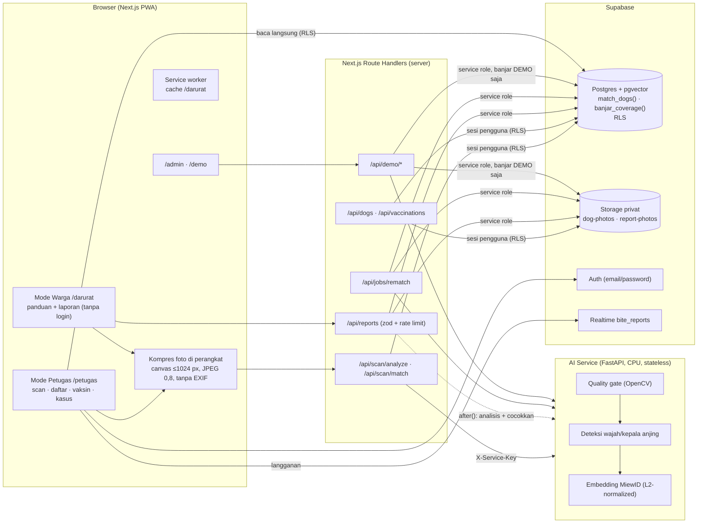
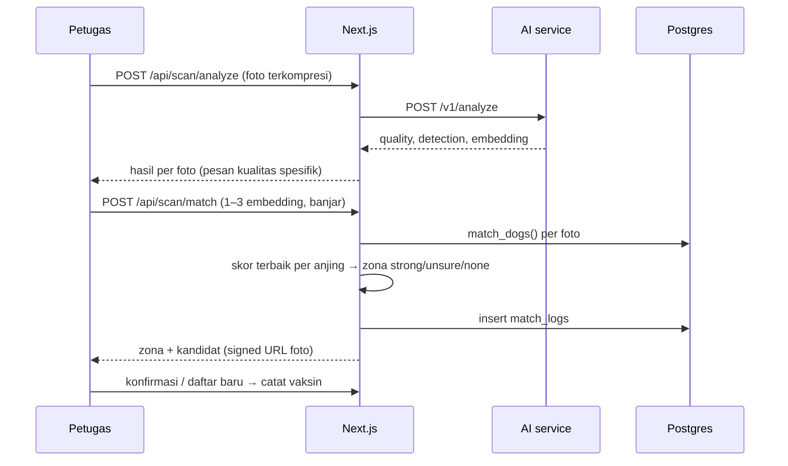

# Arsitektur Tera

## Prinsip

| Keputusan | Alasan |
|---|---|
| AI service **stateless** | Tidak menyimpan foto/embedding; mudah di-deploy ke HF Spaces gratis dan diganti modelnya. |
| **Pencocokan di Postgres** (`match_dogs`) | Data dan pencocokan di satu tempat, mengikuti RLS; tidak ada indeks vektor kedua yang harus disinkronkan. |
| Kunci service role **hanya di server** | Dipakai untuk laporan warga, job rematch, dan mode demo. Operasi petugas memakai sesi pengguna agar RLS ikut berlaku. |
| Laporan warga **tidak menunggu AI** | Kode kasus dikembalikan dulu; analisis foto berjalan di `after()`. AI mati tidak pernah menggagalkan laporan. |
| Fallback eksplisit | Timeout AI 15 detik → "Catat tanpa verifikasi AI" (`ai_status = pending`) → `/api/jobs/rematch` mengisi embedding dan menandai calon duplikat. |

## Alur scan petugas

## Lokasi kode penting

| Bagian | File |
|---|---|
| Logika zona (fungsi murni + test) | `lib/match/zone.ts`, `tests/unit/zone.test.ts` |
| Pemanggilan AI service | `lib/ai/client.ts` (timeout 15 s, kontrak divalidasi zod) |
| Pencocokan + log | `lib/match/run.ts`, `supabase/migrations/20261108000300_functions.sql` |
| Skema, RLS, storage | `supabase/migrations/` |
| Laporan warga | `app/api/reports/route.ts`, `lib/reports.ts` |
| Job rematch | `app/api/jobs/rematch/route.ts`, `lib/rematch.ts` |
| AI service | `ai-service/app/` |
